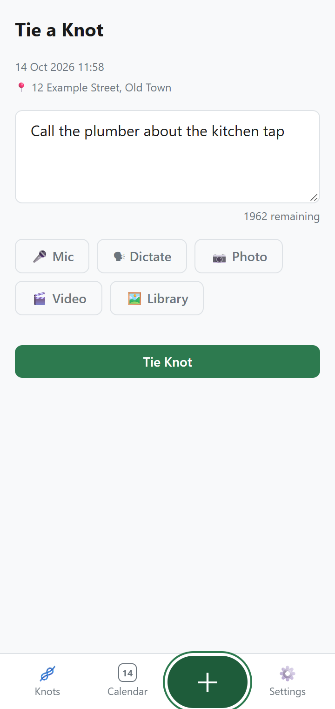
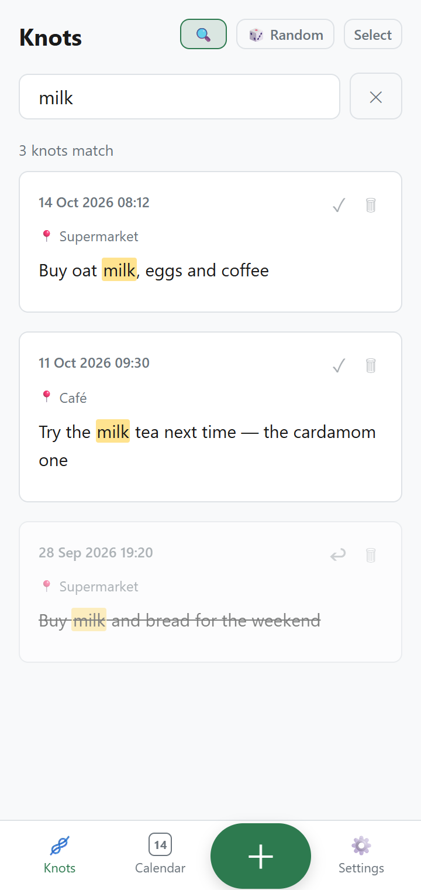
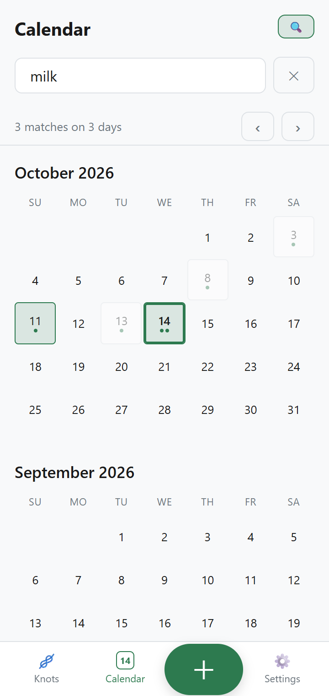

# e-Handkerchief

Tie a knot to remember: a mobile-first, offline-first PWA for quick, location-aware reminders you capture by voice, photo, video or text.

<p align="center">
  
  
  
</p>

## Try it

Open the live app: [https://sescc.github.io/e-handkerchief/](https://sescc.github.io/e-handkerchief/), then use your browser's **Install** / **Add to Home Screen** option.

Google Drive backup on this instance is limited to invited testers. To use backup with your own Google account, [self-host](#self-hosting) your own copy.

## Highlights

- **Capture in one tap.** A knot is text, photos, videos and voice recordings with an automatic timestamp and GPS location. Offline, it waits for a GPS fix for up to 2 minutes and fills in the street address once you're back online.
- **Voice to text, three ways.**
  - **Mic** records audio and transcribes it live while recording when online; when offline the audio is saved and transcribed later.
  - **Dictate** is live speech-to-text. Dictate also works offline on devices with offline speech recognition.
  - **Library › Audio file** attaches an existing recording (MP3, M4A, WAV, OGG, FLAC, WEBM), transcribed later via your transcription Worker.
- **Find things.** Search the Knots list by text, transcript or place (ignores case and accents; every word must match). The Calendar shares the same search and highlights the matching days. Browse by month, tap a day to see its knots with small photo, video and voice thumbnails.
- **Check off, don't delete.** Check off knots you've dealt with; they fade, then leave the list at your chosen "new day starts at" time but stay in the Calendar. **🎲 Random** opens a random unchecked knot.
- **Share.** One knot or several at once, through your device's own share sheet (with media attached where supported).
- **Offline-first.** Everything is stored on your device in IndexedDB and works offline after the first load. An optional quick-capture notification and home-icon shortcut open Capture in one tap.
- **Optional Google Drive backup.** Two-way sync across your devices on the same Google account. If a knot was edited on two devices, you review a diff and choose which version to keep; nothing is overwritten silently.

## Privacy

- Knots live in your browser's IndexedDB on your own device. No e-Handkerchief server stores them and the app has no accounts of its own; the only copy off your device is in your own Google Drive, and only if you turn backup on.
- Google Drive backup is opt-in per user. It uses the Drive **app-data folder** scope only, so the app can read and write only its own backup files, never the rest of your Drive.
- Secrets exist only in your own Cloudflare Workers (the Google OAuth client secret, the Groq API key). Nothing secret is committed or injected into the public site.
- Street addresses come from OpenStreetMap's Nominatim reverse-geocoding service, which receives the coordinates of a knot when an address is looked up. Live speech recognition (Mic and Dictate) uses your browser's speech service, which on Chrome may send the audio to Google's cloud (unless the device recognises speech on-device). Transcribing saved audio later, if you set up a Worker, sends that audio to Groq through your Worker.

## Self-hosting

The project has three independently deployed parts:

| Part | Where | Needed for |
| ---- | ----- | ---------- |
| The site (this repo's PWA) | GitHub Pages, deployed by `.github/workflows/deploy.yml` | **Required** |
| `oauth-worker/` | Your Cloudflare account | Google Drive backup |
| `transcribe-worker/` | Your Cloudflare account | Transcribing saved audio later (optional; each user sets its URL in Settings) |

Short version:

1. Fork the repo, enable Actions in the fork's **Actions** tab, and in **Settings → Pages** set the source to **GitHub Actions**. Pushing to `main` deploys the site, but the first deploy fails until step 2 or 3 is done.
2. **Drive backup:** create a Google OAuth *Web application* client with your site URL as the redirect URI, deploy `oauth-worker/` (see its README), then add the repository secrets `GOOGLE_CLIENT_ID` and `OAUTH_BROKER_URL`. Unless you opt out (below), the deploy **fails** without both secrets.
3. **No Drive backup:** set the repository **variable** `DRIVE_BACKUP` to `off` (Settings → Secrets and variables → Actions → Variables). The deploy then skips the Google secrets and the app hides Cloud Backup.
4. **Transcription (optional):** deploy `transcribe-worker/` with your Groq API key (see its README), then paste its URL into the app's **Settings → Transcription server URL**.

**When to redeploy the Workers.** A normal push deploys only the site, never the Workers. Run `npx wrangler deploy` in a Worker's folder when you change its source or `wrangler.toml`. Rotating a secret (Groq key, Google client secret) or changing `ALLOWED_ORIGIN` uses `npx wrangler secret put <NAME>` and takes effect immediately without a redeploy.

**Custom domain or renamed repo checklist:**

- [ ] Google Cloud Console: update the OAuth client's authorized redirect URI and JavaScript origin (must equal the site URL including the trailing slash).
- [ ] `ALLOWED_ORIGIN` secret on **both** Workers includes the new origin (comma-separated list supported; add the new one before removing the old).
- [ ] If a Worker's own URL changed: update the `OAUTH_BROKER_URL` secret and re-run the deploy; and update the transcription URL in the app's Settings.

Full step-by-step instructions: [docs/guide/self-hosting.md](docs/guide/self-hosting.md).

## Local development

```sh
npm ci            # installs TypeScript
npm test          # compiles, then runs every test
python -m http.server 8080   # or: npx serve .   (then open http://localhost:8080)
```

Details (HTTPS for device testing, the service-worker rule, test layout) are in [CONTRIBUTING.md](CONTRIBUTING.md).

## Project structure

```
index.html, app.css, manifest.webmanifest, config.js   App shell, styles, PWA manifest, deploy-time config
sw.ts                                                  Service worker (compiled to sw.js)
src/                                                   App code (TypeScript, compiled in place), plus *.chartest.ts tests
icons/                                                 PWA icons
scripts/                                               Icon generator and the test runner
oauth-worker/                                          Cloudflare Worker: Google OAuth token broker
transcribe-worker/                                     Cloudflare Worker: Groq Whisper transcription proxy
docs/guide/                                            User and operator guide (mirrored to the GitHub Wiki)
.kiro/specs/e-handkerchief/                            Requirements and design (the spec of record)
```

For the file-level tree, see [.kiro/specs/e-handkerchief/design.md](.kiro/specs/e-handkerchief/design.md).

## Docs

- [User and operator guide](docs/guide/Home.md), also published on the GitHub Wiki: getting started, capturing, organising, sharing, cloud backup, self-hosting, troubleshooting.
- [Requirements](.kiro/specs/e-handkerchief/requirements.md) and [design](.kiro/specs/e-handkerchief/design.md).

## Contributing and license

Contributions are welcome; see [CONTRIBUTING.md](CONTRIBUTING.md).

Licensed under the [PolyForm Noncommercial License 1.0.0](LICENSE). It permits non-commercial use, forking and self-hosting. It is a source-available license, not an OSI-approved open-source license.
